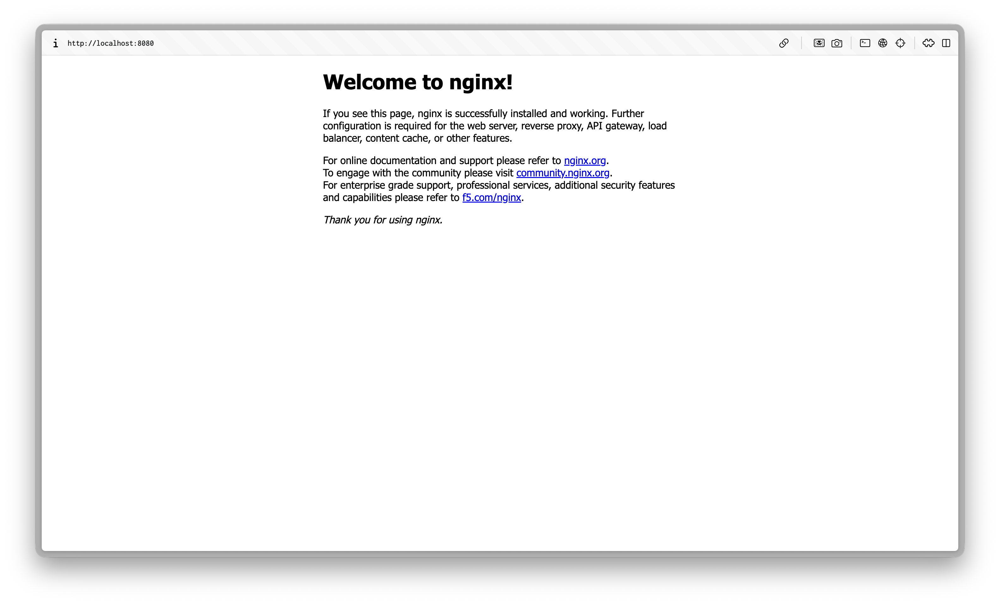
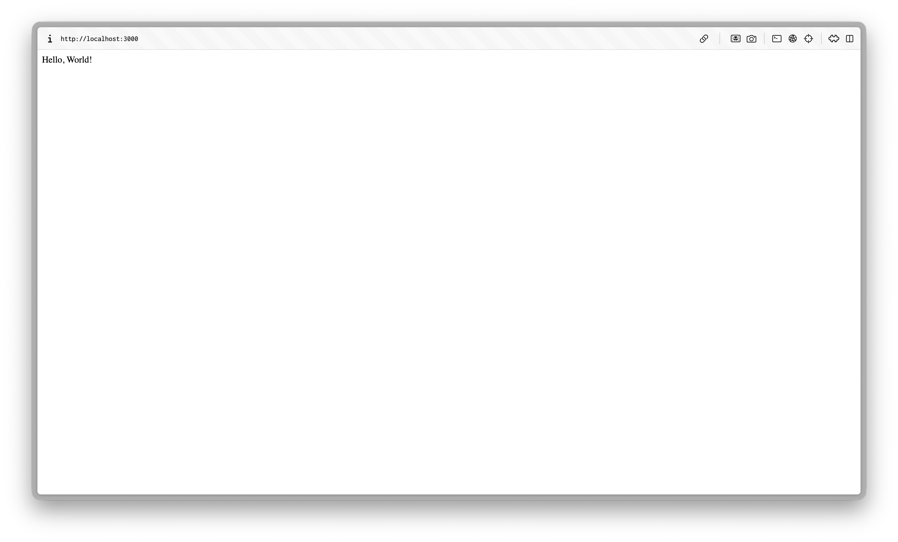

# Exercice : Manipulation de base des conteneurs

1. Vérifiez la version de Docker :

   ```bash
   > docker --version
   Docker version 29.8.2, build 7fc2dff
   ```

2. Listez les images disponibles sur votre machine :

   ```bash
   > docker images
   IMAGE   ID             DISK USAGE   CONTENT SIZE   EXTRA
   ```

3. Téléchargez une image depuis Docker Hub :

   ```bash
   > docker pull hello-world
   Using default tag: latest
   latest: Pulling from library/hello-world
   58dee6a49ef1: Pull complete
   c3bdf82c34d1: Download complete
   Digest: sha256:c567b231f65614688711a75f31518a064258a51d442117a3e771a3a8fdba78ef
   Status: Downloaded newer image for hello-world:latest
   docker.io/library/hello-world:latest
   ```

4. Exécutez un conteneur à partir de l'image :

   ```bash
   > docker run hello-world
   Hello from Docker!
   This message shows that your installation appears to be working correctly.
   ...
   ```

5. Listez les conteneurs en cours d'exécution :

   ```bash
   > docker ps
   CONTAINER ID   IMAGE     COMMAND   CREATED   STATUS    PORTS     NAMES
   ```

6. Listez tous les conteneurs (actifs et stoppés) :

   ```bash
   > docker ps -a
   CONTAINER ID   IMAGE         COMMAND    CREATED         STATUS                     PORTS     NAMES
   6cdc713d12e1   hello-world   "/hello"   3 minutes ago   Exited (0) 3 minutes ago             elated_hopper
   ```

7. Supprimez un conteneur :

   ```bash
   > docker rm 6cdc713d12e1
   6cdc713d12e1
   ```

8. Supprimez une image :

   ```bash
   > docker rmi c567b231f656
   Untagged: hello-world:latest
   Deleted: sha256:c567b231f65614688711a75f31518a064258a51d442117a3e771a3a8fdba78ef
   ```

# Exercice : Création d'un serveur web avec Docker

1. Téléchargez l'image officielle Nginx :

   ```bash
   > docker pull nginx
   Using default tag: latest
   latest: Pulling from library/nginx
   1f7e08c0f6ab: Pull complete
   998fb033610b: Pull complete
   3559a01b6a80: Pull complete
   c64233207369: Pull complete
   34a564bc5d28: Pull complete
   acd43e9bebc3: Pull complete
   c19b54656735: Pull complete
   61b74d3d884f: Download complete
   986a63116111: Download complete
   Digest: sha256:165ddde8751e75a1c907d24ef10d9f6deb08b57e0fe56caf67512486aff76d82
   Status: Downloaded newer image for nginx:latest
   docker.io/library/nginx:latest
   ```

2. Lancez un conteneur Nginx en arrière-plan :

   ```bash
   > docker run -d -p 8080:80 --name mon_nginx nginx
   b4ff42c1150273a96882b8d7d9d9d0f5f4aada3e70d79632dba920032eb2077c
   ```

3. Vérifiez que le conteneur est actif :

   ```bash
   > docker ps
   CONTAINER ID   IMAGE     COMMAND                  CREATED          STATUS          PORTS                                     NAMES
   b4ff42c11502   nginx     "/docker-entrypoint.…"   45 seconds ago   Up 45 seconds   0.0.0.0:8080->80/tcp, [::]:8080->80/tcp   mon_nginx
   ```

4. Accédez à la page dans votre navigateur pour voir la page par défaut de Nginx.
   [http://localhost:8080](http://localhost:8080)
   

5. Arrêtez le conteneur :

   ```bash
   > docker stop mon_nginx
   mon_nginx
   ```

6. Supprimez le conteneur :

   ```bash
   > docker rm mon_nginx
   mon_nginx
   ```

# Exercice : Déploiement d'une application Python Flask

> [!NOTE] Objectif
> Créer et lancer une application web simple avec Flask à l’aide de Docker.

Consignes :

- Créez un fichier app.py contenant une application Flask minimale. (hello world)

  ```python
  from flask import Flask

  app = Flask(__name__)

  @app.route("/")
  def hello():
      return "Hello, World!"

  if __name__ == "__main__":
      app.run(host="0.0.0.0", port=3000)
  ```

- Écrivez un Dockerfile pour construire l’image de l’application.

  ```Dockerfile
  # Utiliser l'image Python officielle comme image de base
  FROM python:3.12-slim

  # Définir le répertoire de travail à /app
  WORKDIR /app

  # Copier le code de l'application Flask dans le conteneur
  COPY app.py ./

  # Installer les dépendances Python
  RUN pip install --no-cache-dir Flask

  # Exposer le port sur lequel l'application Flask fonctionnera
  EXPOSE 3000

  # Définir la commande pour exécuter l'application Flask
  CMD ["python", "app.py"]
  ```

- Construisez l’image et lancez un conteneur.

  ```bash
  > docker build -t python-app .
  [+] Building 2.3s (10/10) FINISHED
  => [internal] load build definition from Dockerfile
  => => transferring dockerfile: 483B
  => [internal] load metadata for docker.io/library/python:3.12-slim
  ...
  => => naming to docker.io/library/python-app:latest
  => => unpacking to docker.io/library/python-app:latest

  View build details: docker-desktop://dashboard/build/orbstack/orbstack/pirfkrnh7mwav2eyv56e6rxyb

  > docker run -p 3000:3000 python-app
  * Serving Flask app 'app'
  * Debug mode: off
  WARNING: This is a development server. Do not use it in a production deployment. Use a production WSGI server instead.
  * Running on all addresses (0.0.0.0)
  * Running on http://127.0.0.1:3000
  * Running on http://192.168.215.2:3000
  Press CTRL+C to quit
  ```

- Testez l’application depuis votre navigateur.
  [http://localhost:3000](http://localhost:3000)
  
