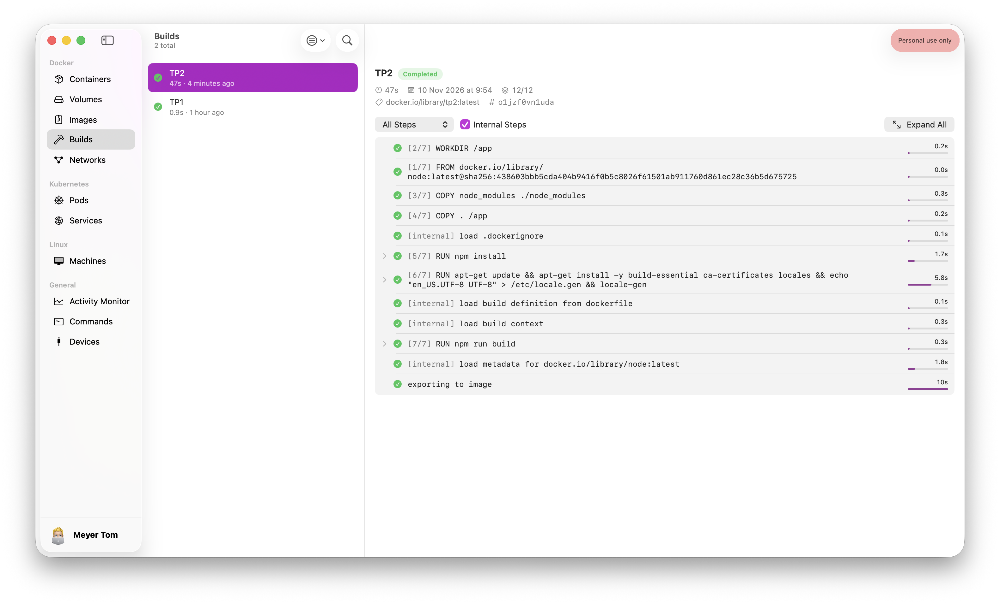
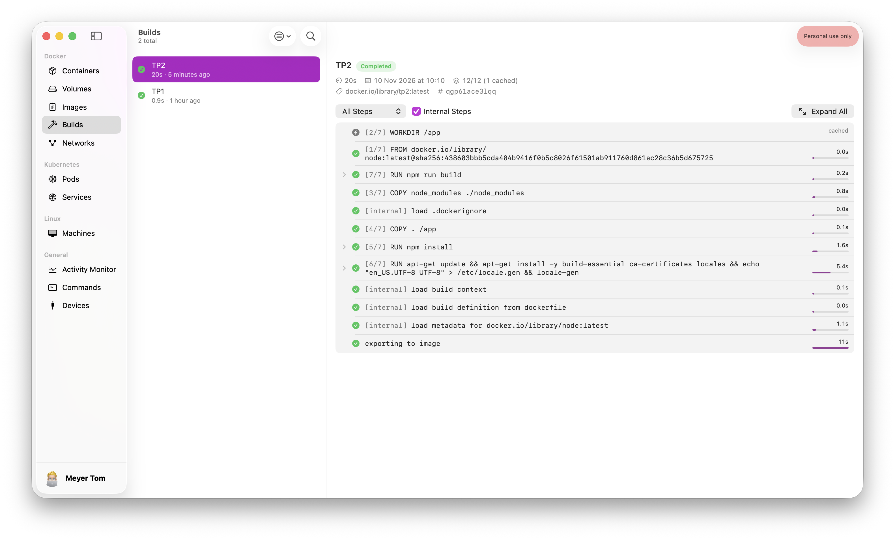

# TP2 : Optimisation d'une application Node.js avec Docker

## Mesure initiale

```bash
> docker build --no-cache -t tp2 .
```

Le premier build a duré environ 47 secondes, car l'image `node:latest` devait être téléchargée. Un second build sans cache, avec l'image de base déjà présente sur la machine, a duré environ 20 secondes. Cette seconde mesure sera utilisée comme référence pour la suite.






La taille de l'image est d'environ 1,88 GB :


| Version | Temps de build | Taille de l'image |
| --- | ---: | ---: |
| Image initiale | 20 s | 1,88 GB |