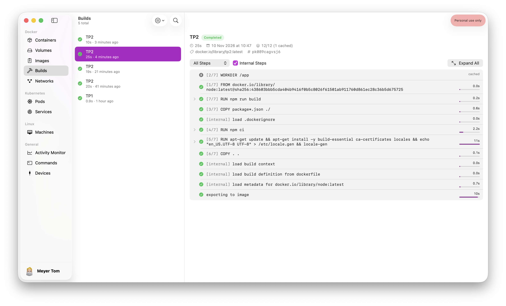
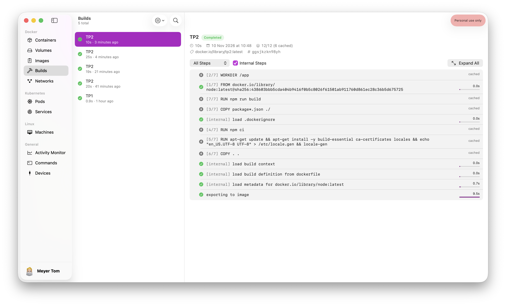
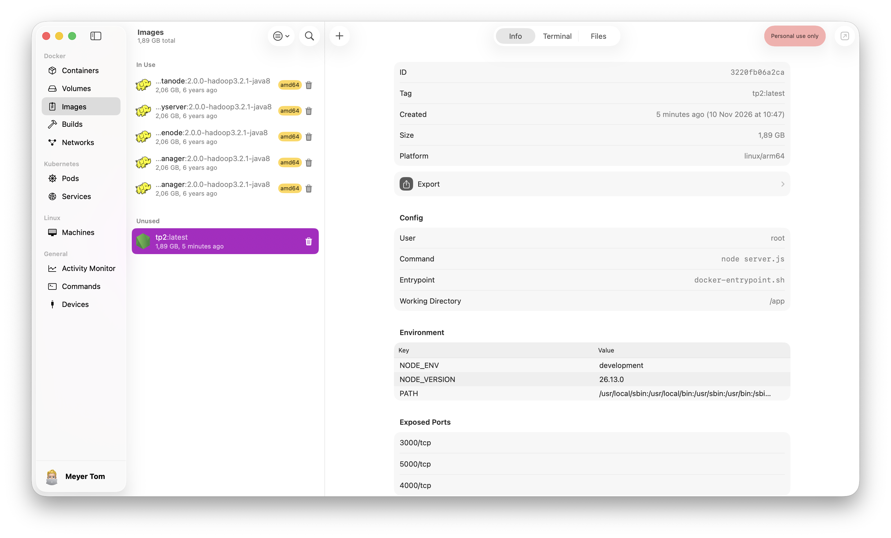

# TP2 : Optimisation d'une application Node.js avec Docker

## Mesure initiale

```bash
> docker build --no-cache -t tp2 .
```

Le premier build a duré environ 47 secondes, car l'image `node:latest` devait être téléchargée. Un second build sans cache, avec l'image de base déjà présente sur la machine, a duré environ 20 secondes. Cette seconde mesure sera utilisée comme référence pour la suite.


La taille de l'image est d'environ 1,88 GB :


| Version | Temps de build | Taille de l'image |
| --- | ---: | ---: |
| Image initiale | 20 s | 1,88 GB |

## Ajout `.dockerignore` et suppression des node_modules

On ajout `.dockerignore` pour éviter d'envoyer des fichiers inutiles ou sensibles dans le contexte de build :

```dockerignore
node_modules
.git
*.log
.env
.env.*
!.env.example
```

On supprime aussi la ligne qui copie les node_modules dans l'image, car elles ne sont pas nécessaires (elles seront installées directement dans le conteneur) :

```dockerfile
COPY node_modules ./node_modules
```

Après cette modification, le build dure 19 secondes et l'image mesure environ 1,89 GB. Pas grand chose n'a changé par rapport à la version initial. Cette étape permet surtout de rendre le build plus propre, plus sûr et indépendant de la machine locale.


| Version | Temps de build | Taille de l'image |
| --- | ---: | ---: |
| Image initiale | 20 s | 1,88 GB |
| Avec `.dockerignore` | 19 s | 1,89 GB |

## Optimisation du cache des dépendances

Les fichiers `package.json` et `package-lock.json` sont maintenant copiés avant le reste de l'application :

```dockerfile
COPY package*.json ./
RUN npm ci
COPY . .
```

La commande `npm ci` utilise directement le fichier `package-lock.json`. L'installation est donc reproductible et la couche contenant les dépendances peut être réutilisée tant que les fichiers `package*.json` ne changent pas.

Le build sans cache dure 25,4 secondes. Lorsque les couches sont déjà en cache, il dure 10,5 secondes, soit environ 50% de temps en moins. La taille reste à 1,89 GB, car cette étape optimise le temps de build et non le contenu de l'image finale.







| Version | Temps de build | Taille de l'image |
| --- | ---: | ---: |
| Image initiale | 20 s | 1,88 GB |
| Avec `.dockerignore` | 19 s | 1,89 GB |
| Cache optimisé, sans cache existant | 25 s | 1,89 GB |
| Cache optimisé, avec cache | 10 s | 1,89 GB |

